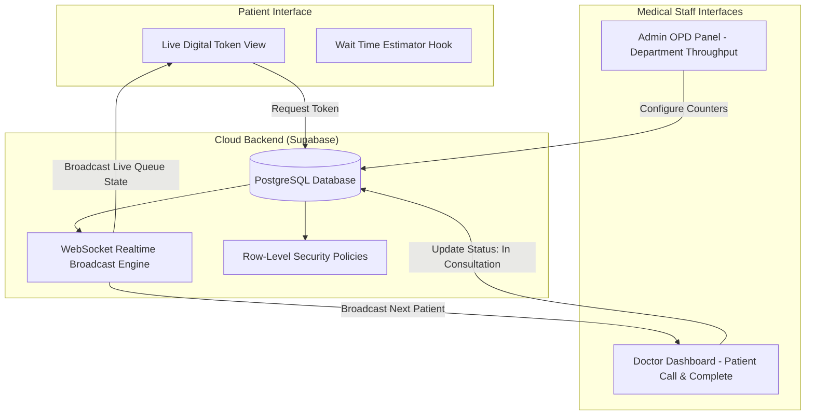

# MediQueue — Hospital & Clinic Outpatient Queue Coordination Platform

> A real-time outpatient department (OPD) queue management system providing live digital tokens, predictive wait-time modeling, and dedicated Doctor and Admin workflow portals built with React 18, Vite, and Supabase.

[](https://react.dev/)
[](https://www.typescriptlang.org/)
[](https://supabase.com/)
[](https://tailwindcss.com/)

---

## Executive Overview

MediQueue (`Queue-buddy-final`) is an enterprise-grade outpatient department (OPD) workflow coordination system engineered to eliminate physical hospital waiting room congestion. The platform replaces antiquated physical paper tokens with a synchronized digital queue infrastructure: patients monitor real-time token progression and algorithmic wait times on mobile devices, while medical personnel and administrators orchestrate patient transitions across specialized Doctor and Admin control dashboards.

---

## Core Capabilities & Features

### Implemented Production Features
- **Dynamic Digital Token Dispensation:** Issues categorized consultation tokens (General OPD, Specialist Review, Emergency Priority).
- **Predictive Wait-Time Engine (`src/hooks/useWaitTime.ts`):** Dynamically computes remaining wait durations based on active physician consultation throughput.
- **Dedicated Doctor Consultation Portal (`src/pages/DoctorDashboard.tsx`):** Enables physicians to call the next patient, flag absent tokens, complete consultations, or transfer cases.
- **Hospital Administration Control Center (`src/pages/AdminPanel.tsx`):** Real-time monitoring of active counters, doctor allocation, daily patient volume metrics, and department queues.
- **Live WebSocket Synchronization:** Supabase PostgreSQL Realtime subscriptions broadcast instantaneous token changes without polling overhead.
- **Production Database Schema:** Complete version-controlled SQL migration scripts (`supabase/migrations/20260112102000_admin_doctor_features.sql`).

---

## System Architecture



---

## Directory Structure

```text
Queue-buddy-final/
├── src/
│   ├── components/
│   │   ├── admin/           # Administrative department and counter controls
│   │   ├── doctor/          # Doctor consultation caller and history
│   │   ├── home/            # Public patient token generation and status viewer
│   │   ├── layout/          # Application headers, navigation, and badges
│   │   └── ui/              # Modular shadcn component abstractions
│   ├── hooks/               # useWaitTime, useAuth, and queue subscription hooks
│   ├── lib/                 # demoData, notifications, and seedData utilities
│   ├── pages/               # AdminPanel, DoctorDashboard, Auth, and Patient Views
│   └── integrations/        # Supabase database client and generated types
├── supabase/
│   └── migrations/          # Version-controlled PostgreSQL migration schemas
├── .env.example             # Clean environment variable specification
└── README.md                # Master repository technical documentation
```

---

## Setup & Installation

```bash
# Clone the repository
git clone https://github.com/StratagemVX/Queue-buddy-final.git
cd Queue-buddy-final

# Install dependencies
npm install

# Start local server
npm run dev
```

---

## Environment Configuration (`.env.example`)

```env
VITE_SUPABASE_URL=https://your-project.supabase.co
VITE_SUPABASE_PUBLISHABLE_KEY=your-supabase-publishable-key
```

---

## Security & Deployment Notes

The React client uses the Supabase publishable key. A publishable key is intended for browser use only when the database schema and Row Level Security policies correctly restrict access. Never expose `SUPABASE_SERVICE_ROLE_KEY` in a `VITE_*` variable or browser bundle; keep it only in Supabase Edge Function secrets. Verify every RLS policy and test patient, doctor, and admin authorization independently. The notification Edge Function's authentication/authorization remediation is maintained in a separate security pull request and must be reviewed and deployed before treating that endpoint as protected.

## Contributor Attribution & Profile

- **Lead Engineer:** Chethan Kumar B S (`StratagemVX`)
- **Institution:** Department of Computer Science & Engineering, MVJ College of Engineering
- **GitHub:** [https://github.com/StratagemVX](https://github.com/StratagemVX)
- **Portfolio:** [https://chethan-kumar-portfolio.vercel.app/](https://chethan-kumar-portfolio.vercel.app/)
- **LinkedIn:** [https://linkedin.com/in/chethan-kumar-b-s-781a002bb](https://linkedin.com/in/chethan-kumar-b-s-781a002bb)

## Verification and maintenance

Keep this overview aligned with the actual source and deployment configuration.

### Available package scripts

- `npm run dev` — `vite`
- `npm run build` — `vite build`
- `npm run lint` — `eslint .`
- `npm run preview` — `vite preview`

Manifest-defined commands only; execution and pass/fail status have not been verified in this documentation change.

### Contribution and security notes

- Keep features, architecture, screenshots, and dependency details accurate.
- Never commit real credentials, private keys, production data, or local environment files; use placeholder-only examples and deployment-managed secrets.
- Include steps to reproduce issues and expected versus actual behavior.
- Name external services and environment variables without publishing secret values.
- Run relevant build, lint, and test checks before merging.
