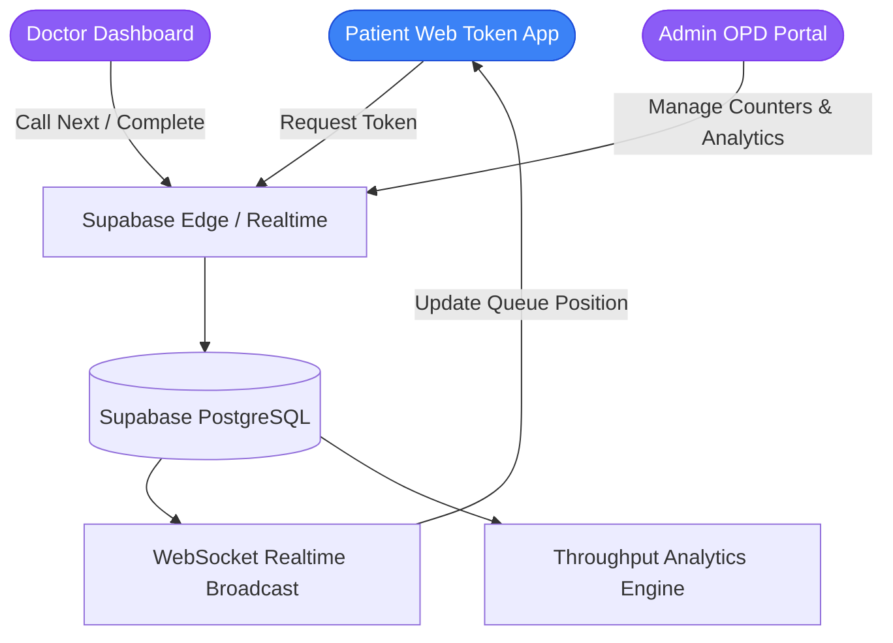

# MediQueue — Hospital & Clinic Queue Management System

> Real-time outpatient department (OPD) queue coordination, token dispatching, wait-time estimation, and role-based doctor/admin portals built with React 18, Vite, and Supabase.

---

## 1. Project Title
**MediQueue** (`Queue-buddy-final`) — Real-time Hospital Queue Management and Wait-Time Intelligence Platform.

## 2. Project Overview
MediQueue is a full-stack healthcare workflow automation system designed to eliminate crowded outpatient waiting rooms. Patients receive live digital queue status, real-time token tracking, and algorithmic wait-time estimates, while healthcare professionals access dedicated Doctor and Admin dashboards to manage patient transitions seamlessly.

## 3. Problem Statement
Traditional paper token systems in clinics lead to physical congestion, unknown wait times, and high administrative overhead. Patients cannot anticipate consultation slots, causing crowded lobbies and cross-infection risks. MediQueue provides automated, digital queue progression visible to patients and practitioners simultaneously.

## 4. Key Features
- **Live Digital Token Generation:** Issue categorized tokens (General, Priority, Emergency).
- **Algorithmic Wait-Time Prediction (`useWaitTime.ts`):** Dynamic estimations calculated from real-time doctor consultation pacing.
- **Dedicated Doctor Dashboard (`DoctorDashboard.tsx`):** Call next patient, mark completed, or reassign cases.
- **Hospital Admin Portal (`AdminPanel.tsx`):** Track daily OPD throughput, manage departments, and audit staff queues.
- **PostgreSQL Supabase Backend:** Real-time subscriptions for zero-refresh queue updates.

## 5. Technology Stack
- **Frontend:** React 18, Vite, TypeScript, Tailwind CSS, shadcn/ui, Lucide Icons
- **Backend & Database:** Supabase (PostgreSQL, Realtime WebSockets, SQL Migrations)
- **State & Queries:** TanStack React Query

## 6. System Architecture


## 7. Folder Structure
```
Queue-buddy-final/
├── src/
│   ├── components/
│   │   ├── admin/           # Administrative controls & counter management
│   │   ├── doctor/          # Doctor consultation controls & queue callers
│   │   ├── home/            # Patient token generation & queue viewers
│   │   ├── layout/          # Application headers and navigation
│   │   └── ui/              # Modular UI library (buttons, modals, cards)
│   ├── hooks/               # useWaitTime, useAuth, and queue subscription hooks
│   ├── lib/                 # demoData, notifications, and seedData utilities
│   ├── pages/               # AdminPanel, DoctorDashboard, Auth, and Patient Views
│   └── integrations/        # Supabase database clients and generated types
├── supabase/
│   └── migrations/          # Version-controlled PostgreSQL migration schemas
├── .env.example             # Clean environment variable specification
└── README.md                # Technical system documentation
```

## 8. Installation & Setup
```bash
# Clone the repository
git clone https://github.com/StratagemVX/Queue-buddy-final.git
cd Queue-buddy-final

# Install dependencies
npm install

# Start local server
npm run dev
```

## 9. Environment Variables (`.env.example`)
```env
VITE_SUPABASE_URL=https://your-project.supabase.co
VITE_SUPABASE_ANON_KEY=your-supabase-anon-key
```

## 10. Author & Project Information
- **Lead Developer:** Chethan Kumar B S (`StratagemVX`)
- **Portfolio:** [https://github.com/StratagemVX](https://github.com/StratagemVX)
- **Domain:** HealthTech & Full-Stack System Architecture
