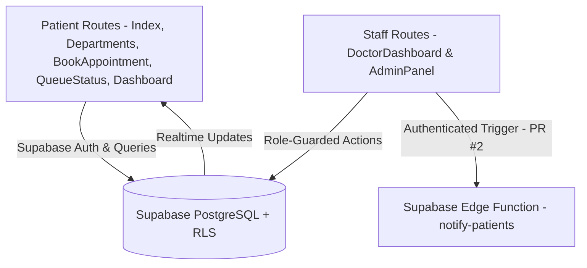

# MediQueue (`Queue-buddy-final`) — Hospital Outpatient Queue Coordination Platform

> Real-time hospital and clinic outpatient department (OPD) queue coordination system providing digital token booking, live wait-time estimation, Doctor and Admin portals, and Supabase Edge Function notifications built with React 18, TypeScript, Vite, and Supabase.

[](https://react.dev/)
[](https://www.typescriptlang.org/)
[](https://supabase.com/)
[](https://tailwindcss.com/)

---

## Executive Overview

**MediQueue** (`Queue-buddy-final`) modernizes outpatient hospital queues by letting patients browse departments, book consultation tokens, and follow live queue status (`/departments`, `/book/:departmentId`, `/queue-status`, `/dashboard`), while doctors manage active consultations (`/doctor`) and administrators oversee counters, doctors, analytics, and system settings (`/admin`).

> **Security Remediation Status (`main` vs. Open Draft PR #2 — `security/authorize-notify-edge-function`):**
> - **PR #2** removes tracked `.env` from git; adds placeholder `.env.example`; enforces authorization, strict CORS validation, and Edge Function secret hygiene in `supabase/functions/notify-patients/index.ts`; hardens signup role assignment, Supabase RLS policies, and demo-mode gates via `supabase/migrations/20261111000000_harden_roles_and_rls.sql` and `src/lib/security.ts`; fixes lint errors; adds `typecheck` & `vitest` security tests (`src/lib/security.test.ts` — 8 tests passed); and adds `.github/workflows/quality.yml` (verified passing in CI).

---

## Architecture & Directory Structure



```text
Queue-buddy-final/
├── .github/workflows/quality.yml      # CI: npm ci, audit, typecheck, lint, test, build (PR #2)
├── src/
│   ├── components/
│   │   ├── admin/                     # AnalyticsDashboard, DepartmentManagement, DoctorManagement, SystemSettings
│   │   ├── doctor/                    # DoctorSchedule, DoctorStats
│   │   ├── home/                      # HeroSection, FeaturesSection, HowItWorks
│   │   └── layout/                    # Header
│   ├── hooks/                         # useAuth.tsx, useWaitTime.ts, use-mobile.tsx, use-toast.ts
│   ├── integrations/supabase/         # client.ts, types.ts
│   ├── lib/                           # security.ts & security.test.ts (PR #2), demoData.ts, notifications.ts, seedData.ts
│   ├── pages/                         # Index, Auth, Departments, BookAppointment, QueueStatus, Dashboard, DoctorDashboard, AdminPanel, NotFound
│   └── App.tsx
├── supabase/
│   ├── functions/notify-patients/     # Patient notification Edge Function
│   └── migrations/                    # PostgreSQL schema, seed & RLS hardening SQL migrations
├── .env.example                       # Placeholder config (PR #2)
├── package.json
└── README.md
```

---

## Setup, Environment & Verification

### Local Setup
```bash
git clone https://github.com/StratagemVX/Queue-buddy-final.git
cd Queue-buddy-final

npm ci --ignore-scripts
cp .env.example .env
npm run dev
```

### Environment Variables (`.env.example`)
| Variable | Scope | Purpose |
|---|---|---|
| `VITE_SUPABASE_PROJECT_ID` | Client | Supabase project ID |
| `VITE_SUPABASE_URL` | Client | Supabase API URL |
| `VITE_SUPABASE_PUBLISHABLE_KEY` / `VITE_SUPABASE_ANON_KEY` | Client | Browser publishable anon key (safe only alongside strict PostgreSQL RLS) |
| `CORS_ALLOWED_ORIGINS`, `SUPABASE_SERVICE_ROLE_KEY` | Supabase Edge Function Secrets | Configured via `supabase secrets set`; never expose in client `VITE_*` variables |

### Available Package Scripts (`package.json`)
| Script | Command | Notes |
|---|---|---|
| `npm run dev` | `vite` | Start Vite dev server |
| `npm run build` | `vite build` | Production build |
| `npm run typecheck` | `tsc --noEmit` | Added in PR #2 |
| `npm run lint` | `eslint .` | ESLint checks |
| `npm test` | `vitest run` | Added in PR #2 (`src/lib/security.test.ts`) |
| `npm run preview` | `vite preview` | Preview built output |

---

## Contributor Attribution & Profile

- **Lead Engineer:** Chethan Kumar B S (`StratagemVX`)
- **Related Prototype:** [StratagemVX/queue-buddy](https://github.com/StratagemVX/queue-buddy) (private preliminary prototype)
- **GitHub:** [https://github.com/StratagemVX](https://github.com/StratagemVX)
- **Portfolio:** [https://chethan-kumar-portfolio.vercel.app/](https://chethan-kumar-portfolio.vercel.app/)
- **LinkedIn:** [https://linkedin.com/in/chethan-kumar-b-s-781a002bb](https://linkedin.com/in/chethan-kumar-b-s-781a002bb)
